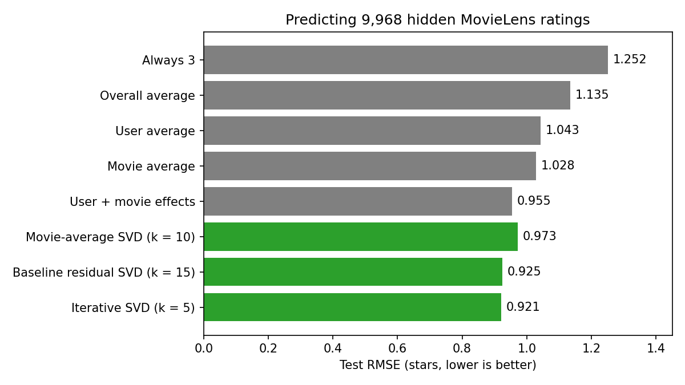
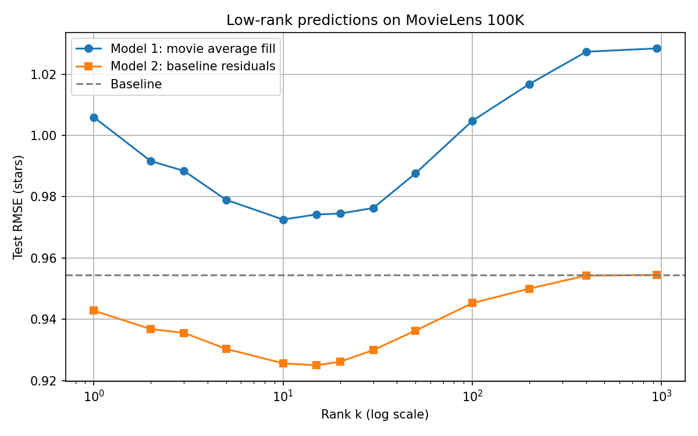

# Predicting Movie Ratings with Low-Rank Matrices

**On 9,968 hidden ratings, the rank-15 model got an RMSE of 0.925 stars, about 3.1% lower than the best average-based model.**

## The question

Can I guess how someone would rate a movie they haven't seen? I wanted to see if using patterns in people's ratings would get me closer than using averages alone.

## The idea

I put the ratings in a matrix with one row per user and one column per movie. About 94% of it is empty. If a few shared tastes explain a lot of the ratings, then a low-rank matrix can capture some of those patterns.

I start with a baseline that combines the overall average, how generously a user usually rates, and how well a movie usually does. Then I use singular value decomposition (SVD) to estimate what's left over. I hid about 10% of the ratings before fitting the models and used those ratings to measure the error.

## Results

1. **Subtracting the baseline helped.** Filling the gaps with movie averages and then using SVD gave an RMSE of 0.9726 stars at its best rank. SVD on the leftover ratings scored 0.9250 stars at rank 15, which I picked using validation ratings. Iterative SVD reached 0.9206 after 15 rounds at rank 5, with rank 5 picked from the test results.

   

2. **Ten ratings changed a few recommendations.** After I added my ratings, the SVD and baseline still shared 9 of their top 10 picks. The SVD raised my predicted rating for *Fargo* by 0.12 stars and lowered *The English Patient* by 0.11 stars.

## Limitations

With only 10 ratings from me, most of my top picks were still crowd favorites. The model also needs ratings for each movie, so it has little to go on when a movie is new.

## How to run it

Open any notebook below, click **Open in Colab**, and choose **Runtime → Run all**. Each notebook downloads MovieLens when it needs it. The iterative SVD section in notebook 03 takes the longest because it repeats the SVD 15 times at each rank.

1. [Ratings as a matrix](Notebooks/01_ratings_matrix.ipynb)
2. [Train/test split and baselines](Notebooks/02_baselines.ipynb)
3. [Low-rank predictions](Notebooks/03_low_rank_prediction.ipynb)
4. [Hidden factors and my recommendations](Notebooks/04_what_it_learned_my_ratings.ipynb)
5. [Model comparison chart](Notebooks/05_hero_figure.ipynb)

I keep the functions I reuse in [evaluate.py](Src/evaluate.py) and [models.py](Src/models.py). If you're using Jupyter locally, install the packages with `pip install -r requirements.txt` first.

## Data and references

- MovieLens 100K, GroupLens Research. The notebook downloads the data from the original source at runtime. [Data and license](https://grouplens.org/datasets/movielens/100k/)
- F. M. Harper and J. A. Konstan (2015). The MovieLens Datasets: History and Context. *ACM Transactions on Interactive Intelligent Systems*, 5(4). [Paper](https://doi.org/10.1145/2827872)
- C. Eckart and G. Young (1936). The Approximation of One Matrix by Another of Lower Rank. *Psychometrika*, 1, 211–218. [Paper](https://doi.org/10.1007/BF02288367)

## Use of AI tools

I used OpenAI Codex to help organize the notebooks, review and revise explanations and help debug some of the code

## About

Aryan Anand, MATH 344L (Applied Linear Algebra Lab), University of South Carolina, Fall 2026.
